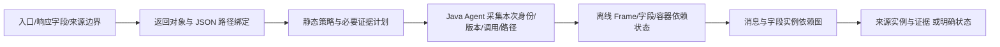

# 62 查询统一版本来源核验与首次运行可用性

**统一冻结版的联合来源覆盖经固定复验达到 382/431（88.63%），但首次端到端验收尚未全部通过：原版 Orders 存在无预热部署的早期请求 Future 超时。** 两个结论必须分别引用，不能把复验成功覆盖首轮失败，也不能把 100% 的条件来源匹配率写成全范围正确率。

算法冻结 `2cefacdc577b4bf1b8635201efcacf58c221ab85`。本组 RPC 来源起点是目标服务实际消费的响应字段，与旧 Orders.total 成本任务的发送端 Carts 序列化边界不同，不能合并指标。原业务仍使用九个原版 JAR；规划器、Agent、离线内核及十份运行时/公共契约留哈希。全部查询的策略与拒绝原因在运行前保存；当前 61/62 规划接纳，1/62 UUID 类型拒绝。29 个未测候选继续封存。原 `2b3b929` 首轮和全部后续开发失败保留。

输入核对中，Train Ticket 请求、数据库文档及业务响应逐项相同；Sock Shop 恢复原客户/地址/卡的公开字段与 ID、购物车 Item.id 及值。未查询的 Cart.id 使用确定性物理主键，认证字段为不参与当前 GET 的测试值，差异明确保存在 input-audit；不称整个数据库字节完全相同。生成的订单 ID 和时钟另按环境量核验。实验真值依据原业务人工审查的投影与当前原始事实，例如 Train.retrieve 明确选择第二次读取；这些规则只用于评分，不进入 TF 传播代码。

## 首轮结果：业务失败不按 N/A 排除

固定 431 个逻辑目标，业务未完成的参考实例仍留在分母。下面先给出未用复验替代的原始结果。

| 模式 | 已知且匹配 | unknown | 规划拒绝 | 业务错误对应参考目标 | 批次中止后未执行目标 |
| --- | ---: | ---: | ---: | ---: | ---: |
| full | 376 | 39 | 10 | 1 | 5 |
| selective | 377 | 39 | 10 | 1 | 4 |

- `full / sockshop-orders-newOrder-address-postcode`：发生原业务 Future 超时；此前成功组另行复核，后续组未发出。原目录 `artifacts/date-effects-capability-20261021/final-capability/all62-orders-serial/full-sockshop-orders-newOrder-address-postcode`。
- `selective / sockshop-orders-newOrder-customer-lastName`：发生原业务 Future 超时；此前成功组另行复核，后续组未发出。原目录 `artifacts/date-effects-capability-20261021/final-capability/all62-orders-serial/selective-sockshop-orders-newOrder-customer-lastName`。

失败捕获中有实际 `Future.get` 的 TimeoutException，未发现 collector problem；这仍属于观测配置下的实际业务失败，不能仅归咎于并行部署。正式 Orders 已与其他业务启动任务隔离，仍发生该问题。本文未改变原业务截止时间或增加 CPU 来消除失败，具体性能根因尚未完成定位。

首轮配对：双方均正确 371 个；full 正确而 selective 未完成 5 个，反向 6 个。总数不能替代逐实例配对。**首轮数据不能支持无条件的端到端能力保持或 100% 可用性。**

## 固定两次复验后的来源结果

[复验协议](capability-business-repeat-protocol-20261021.json)在复验前提交。只复验原业务 Future 超时，不为 unknown、类型拒绝、无效证据或错误来源答案挑成功重跑。完整失败清单在任何复验开始前保存；每个配置两次独立项目/数据卷，保持算法、计划、模式、六组请求及 JVM/资源限制，无额外预热。两次均须完成并通过独立来源评分；第一次固定为来源回执。复验不增加 431 分母。

- `full / sockshop-orders-newOrder-address-postcode`：两次独立复验均通过=true；使用第一次复验作来源回执，第二次作必须通过的佐证。
- `selective / sockshop-orders-newOrder-customer-lastName`：两次独立复验均通过=true；使用第一次复验作来源回执，第二次作必须通过的佐证。

| 模式 | 已知且实例完全匹配 | unknown | 规划拒绝对应目标 | 错误确定答案 | 证据无效 | 固定范围已验证来源率 |
| --- | ---: | ---: | ---: | ---: | ---: | ---: |
| full | 382 | 39 | 10 | 0 | 0 | 88.63% |
| selective | 382 | 39 | 10 | 0 | 0 | 88.63% |

已知答案的条件完全匹配率均为 382/382；这不代表其余 49 个目标已获解答。基线正确的 368/368、原 TF 正确的 213/213 均在新冻结版本的实际捕获中核验；二者联合为 382 个。保守地只看基线有非空来源且正确的目标，也保留 337/337。没有复制 MirrorTaint 的错误答案。

关系口径为 **TP 351 / FP 0 / FN 49**，FN 含 unknown 与拒绝的参考阳性漏检。UUID 拒绝项没有 TF 来源坐标答案，其关系漏检只使用原独立参考真值的关系基数；不能冒充新 TF 对 UUID 的实例匹配。所选来源回执的 421 个目标均有本次原始事实上的独立实例真值，已知 382、unknown 39。

| 应用/模式 | 固定逻辑目标 | 已知匹配 | unknown | 拒绝 |
| --- | ---: | ---: | ---: | ---: |
| sockshop / full | 131 | 113 | 18 | 0 |
| trainticket / full | 300 | 269 | 21 | 10 |
| sockshop / selective | 131 | 113 | 18 | 0 |
| trainticket / selective | 300 | 269 | 21 | 10 |

| 模式 | 至少一个已知答案的查询族 | 至少一个已知答案的入口 | 本组始终没有目标的查询族 |
| --- | ---: | ---: | ---: |
| full | 47/62 | 17/18 | 8 |
| selective | 47/62 | 17/18 | 8 |

八个 Orders 列表查询仍只提供本组 N/A 处理证据，不提供非空元素来源证据。固定 null 字段仍计目标，空来源与 unknown 分开。来源关系、目标实例、查询族、入口和查询请求是不同分母。

## 保留的能力边界

- Basic 三个 trainType helper/转换目标：21 个 unknown，必要效果未获完整解释；不能将缺失来源当空集合。
- Cart 添加三个目标：18 个 unknown。新内核允许原业务修改接收集合，无法证明的所有权和保存效果保守失效；不再用旧只读保护阻止正常 POST。
- Price UUID：一个查询族的 10 个目标规划拒绝，原因是目标类型/序列化投影未支持。实际目标由同版、同入口及相同输入的另一个接受查询的客户端响应核对；**没有运行被拒绝的计划**，也未给出 UUID 来源答案。
- 未见查询泛化、其他主要基线在本任务上的能力，以及本版本的成本优势均未完成验证。此次 62 查询已经参与开发，不能算新封存测试。

## 当前算法的实现机制

用户声明入口、响应字段/Map 路径及目标声明和来源边界；不逐字段写传播公式或预期来源。统一目标绑定先核验返回对象、包装、元素与序列化字段，再按字节码结构选择执行路径。本组策略为 `{'execution-dependency': 37, 'response-forward': 22, 'bounded-scalar': 1, 'field-copy': 1}`，选择发生在业务运行前，不读取基线答案或运行成功状态。



统一内核维护每次调用的栈、局部变量、参数/返回和异常，按实际对象字段版本、数组位置/版本及列表内容阶段维护堆状态；支持范围内的计算、构造、循环、应用调用和 lambda 共用该状态，结果统一写入字段实例图。未解释调用失效可能受影响的状态；同值不能证明来源相同或未改变。有限循环/调用图有静态与动态预算，耗尽是 analysis_limited，不能记作业务 N/A。

公共模型覆盖固定版本的有限 List/stream/Optional、HTTP 包装/实际解码、保存及任务/Future 配对。库模型是人工审查的契约，实际接收者、实现、参数、返回、字段写入和调用闭合必须核验；返回快照仅用于绑定。W3C 消息/span、方向、JSON 路径与对象/字段/版本共同区分来源，不能按 trace-id 或数值合并。数据来源与索引、分支选择证据保持分离。

本轮 Date 修订把精确 Date 的语义毫秒与内部日历缓存区分。只有固定实现、实际渲染/保存编码链和状态检查共同成立，才能保持 Date 依赖；自定义编码器、钩子、回调、同值 setTime 和不透明效果仍不自动获得来源。环境时间在声明字段边界上的投影为空，不能称为常量。详见 [Date 与公共契约机制](DATE-EFFECTS-ALGORITHM-20261021.md)、[HTTP/保存/异步组合机制](ORDERS-END-TO-END-ALGORITHM-20261021.md)。实现仍是 Java/JVM 前端；其他语言的内部依赖还原未由这些实验验证。

当前执行内核以保守多采保证证据闭合；full/selective 来源核验相同不等于已证明新增路径节省成本。本轮没有性能实验，旧 `2b3b929` 和更早成本表不套用于 `2cefacd`。

## 控制、审计与工件

- 最终 Date 控制两模式各 28 目标：16 预期已知匹配、12 预期 unknown，十类必要证据扰动拒绝。
- 接收集合修改控制各 6 目标：2 预期已知匹配、4 预期 unknown；实际业务修改均完成，三类事后成员/阶段证据扰动拒绝。
- 旧集合 profile 各 10/10，原只读契约和虚调用保护继续拒绝违例。应用调用控制各 26 已知匹配/8 预期 unknown，异常、预算及六类证据保护保持。76 项单元检查通过。
- 开发中的 HATEOAS 误启用、HTTP 坐标评分表示差异、旧只读保护干预业务、UUID 伪接纳、初始驱动预检错误及正式早期请求超时均留存，不覆盖原 `3cf6320` 或更早结果。

原始根目录：`artifacts/date-effects-capability-20261021/`；最终冻结及运行位于 `final-capability/`。每个部署保留计划、原版 JAR 哈希、镜像引用、输入/数据库脚本、客户端响应、原始事件、独立真值、预测及清理状态。首次与复验结果分目录；节点日志在 `logs/`。创建/重读补充驱动的旧预声明 customerId 文本存在一处陈旧值，实际请求和原基线始终是固定的 `56e8f576709b70d0ace01fb0`；原文本、启动源码与独立勘误保存在 `cart-create-pair/protocol-correction.json`，捕获和评分未改写。

```bash
python3 experiments/sockshop-mirrortaint/audit_frozen_capability_acceptance.py \
  --root artifacts/date-effects-capability-20261021/final-capability \
  --out artifacts/date-effects-capability-20261021/final-capability/audit-new-directory
```

审计输出 `provenance_union_passed` 表示上述来源联合核验；`unqualified_end_to_end_acceptance` 仍为 false，保留首轮业务失败。复核只写新派生目录，不覆盖原始证据。[汇总快照](capability-acceptance-results-20261021.json)、[逐查询表](capability-acceptance-queries-20261021.csv)及[逐实例配对表](capability-acceptance-instances-20261021.csv)随 Git 保存；完整工件和 Docker 镜像需单独备份。推送交给用户。

下一项优先处理观测配置的早期请求截止时间干扰，进一步核对元数据初始化与调用效果核验的在线代价；然后才恢复当前冻结语义下的成本比较和选择性收缩。39 unknown 与 UUID 拒绝继续如实保留。
