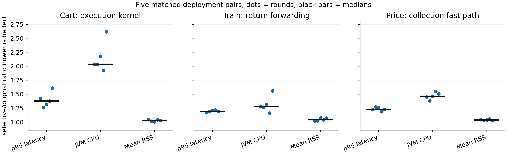
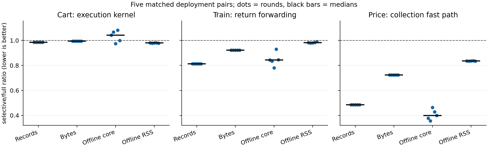

# Jackson隔离版：三类查询的固定负载性能

算法冻结 `76d2050de6634c52db6583832aefa1e6892454c9`。三任务各五轮，原版/full/selective随机顺序、独立容器和数据卷，45次正式部署顺序执行。仅使用本批新捕获；旧成本不移用于新版。

每次预热30秒、测量60秒，固定2请求/秒、并发上限2，资源采样2秒。所有业务JVM统一1CPU/768MiB、堆32m/256m、GC/JIT线程1/2；Mongo各1CPU/384MiB。完整JVM参数、镜像digest、原版JAR、输入与顺序在各config.json。

`source_evidence=true`统一保留：必要字段、身份/版本、调用与异常、响应绑定等证据，加上原始HTTP诊断/独立真值字节，其在线及采集成本均计入本表。本表不是关闭额外诊断后的最低必要开销。full/selective的全局开关和来源核验条件相同。

Cart按运行前统一结构策略选择execution-dependency，当前仍保守保留必要语义证据；Train选择response-forward；票价使用既有字节码生成的collection-computation快速路径。full限于任务纳入的应用类/方法范围，不是整个JVM指令追踪。没有运行后改选成功策略。原版不输出来源，相关离线能力/成本为N/A。外部基线未校准并重新计时本批任务，成本保持N/A。

表内为五次部署中位数；变化使用同轮selective/full或selective/original比值的中位数，并列五轮范围。请求不是独立部署重复。2请求/秒是完成当前负载，不能推断最大吞吐。p99每轮约120个样本，仅作描述。

## Cart：getItems → /*/itemId，新执行内核

full：900请求＝300预热＋600测量；来源完全匹配1350/1350，TP1350/FP0/FN0/unknown0；预热目标450、测量目标900。
selective：900请求＝300预热＋600测量；来源完全匹配1350/1350，TP1350/FP0/FN0/unknown0；预热目标450、测量目标900。

| 指标 | 原版 | full | selective |
| --- | ---: | ---: | ---: |
| 在线p50，ms | 3.951 | 5.382 | 5.325 |
| 在线p95，ms | 4.496 | 6.372 | 6.193 |
| 在线p99，ms | 5.208 | 11.824 | 13.338 |
| 完成吞吐，请求/秒 | 2.000 | 2.000 | 2.000 |
| 错误率 | 0.000 | 0.000 | 0.000 |
| 业务JVM CPU，单核% | 1.512 | 3.087 | 3.345 |
| 业务JVM平均RSS，MiB | 267.200 | 273.240 | 274.524 |
| 业务JVM采样峰值RSS，MiB | 267.883 | 274.527 | 275.566 |
| 测量请求归属事件 | 0 | 8,160 | 8,040 |
| 测量请求归属记录，MiB | 0.000 | 4.587 | 4.560 |
| 整批采集字节，MiB | 0.000 | 11.069 | 11.009 |
| 整批离线核心，秒 | N/A | 1.165 | 1.185 |
| 离线子进程墙时，秒 | N/A | 2.613 | 2.680 |
| 离线子进程CPU，秒 | N/A | 2.571 | 2.638 |
| 同批复算VmHWM，MiB | N/A | 98.207 | 96.133 |
| 请求完成到批次答案p50，秒 | N/A | 32.478 | 32.518 |
| 请求完成到批次答案p95，秒 | N/A | 59.478 | 59.516 |
| 整部署CPU，单核% | 1.763 | 3.341 | 3.597 |
| 整部署平均RSS，MiB | 329.918 | 335.626 | 336.570 |
| 整部署采样峰值RSS，MiB | 330.566 | 336.969 | 337.594 |
| 整批控制台输出，MiB | 0.064 | 0.064 | 0.064 |

| selective/full 配对变化 | 中位数 | 五轮比值范围 |
| --- | ---: | ---: |
| 测量请求事件 | -1.47% | 0.9853–0.9853 |
| 测量请求字节 | -0.61% | 0.9939–0.9939 |
| 离线核心 | +4.17% | 0.9732–1.0812 |
| 离线子进程墙时 | +3.16% | 0.9307–1.0747 |
| 离线CPU | +3.26% | 0.9304–1.0746 |
| 离线峰值RSS | -2.06% | 0.9764–0.9800 |
| 在线CPU | +8.36% | 0.8010–1.3893 |
| 在线p95 | -1.60% | 0.9518–1.1356 |

selective相对原版，配对中位数：p95 +37.82%，业务JVM CPU +103.43%。
在线CPU：范围跨1，不能称稳定改善。
在线p95：范围跨1，不能称稳定改善。
离线核心：范围跨1，不能称稳定改善。
当前新执行路径的记录量缩减有限，不能沿用旧read-forward快速路径的节省比例；语义能力与查询切片收缩是两项不同工作。

## Train：retrieve → /data/economyClass，第二次仓储返回

full：900请求＝300预热＋600测量；来源完全匹配900/900，TP900/FP0/FN0/unknown0；预热目标300、测量目标600。
selective：900请求＝300预热＋600测量；来源完全匹配900/900，TP900/FP0/FN0/unknown0；预热目标300、测量目标600。

| 指标 | 原版 | full | selective |
| --- | ---: | ---: | ---: |
| 在线p50，ms | 4.135 | 4.900 | 4.850 |
| 在线p95，ms | 4.636 | 5.454 | 5.568 |
| 在线p99，ms | 5.736 | 6.976 | 6.358 |
| 完成吞吐，请求/秒 | 2.000 | 2.000 | 2.000 |
| 错误率 | 0.000 | 0.000 | 0.000 |
| 业务JVM CPU，单核% | 1.263 | 1.612 | 1.611 |
| 业务JVM平均RSS，MiB | 265.203 | 277.102 | 280.099 |
| 业务JVM采样峰值RSS，MiB | 266.258 | 278.855 | 281.812 |
| 测量请求归属事件 | 0 | 1,920 | 1,560 |
| 测量请求归属记录，MiB | 0.000 | 1.152 | 1.062 |
| 整批采集字节，MiB | 0.000 | 1.728 | 1.593 |
| 整批离线核心，秒 | N/A | 0.208 | 0.175 |
| 离线子进程墙时，秒 | N/A | 0.401 | 0.346 |
| 离线子进程CPU，秒 | N/A | 0.388 | 0.335 |
| 同批复算VmHWM，MiB | N/A | 44.133 | 43.406 |
| 请求完成到批次答案p50，秒 | N/A | 31.318 | 31.259 |
| 请求完成到批次答案p95，秒 | N/A | 58.317 | 58.259 |
| 整部署CPU，单核% | 1.562 | 1.915 | 1.911 |
| 整部署平均RSS，MiB | 368.117 | 379.846 | 382.770 |
| 整部署采样峰值RSS，MiB | 369.320 | 381.785 | 384.629 |
| 整批控制台输出，MiB | 0.069 | 0.070 | 0.069 |

| selective/full 配对变化 | 中位数 | 五轮比值范围 |
| --- | ---: | ---: |
| 测量请求事件 | -18.75% | 0.8125–0.8125 |
| 测量请求字节 | -7.83% | 0.9217–0.9217 |
| 离线核心 | -15.67% | 0.7808–0.9289 |
| 离线子进程墙时 | -11.97% | 0.8539–0.9550 |
| 离线CPU | -12.32% | 0.8512–0.9530 |
| 离线峰值RSS | -1.78% | 0.9788–0.9913 |
| 在线CPU | +3.59% | 0.8201–1.2394 |
| 在线p95 | +1.43% | 0.9909–1.0279 |

selective相对原版，配对中位数：p95 +18.90%，业务JVM CPU +27.57%。
在线CPU：范围跨1，不能称稳定改善。
在线p95：范围跨1，不能称稳定改善。
离线核心：本批五轮均较低，仅作样本描述。

## 五服务票价：两个prices Map条目，原多来源计算

full：900请求＝300预热＋600测量；来源完全匹配1800/1800，TP4330/FP0/FN0/unknown0；预热目标600、测量目标1200。
selective：900请求＝300预热＋600测量；来源完全匹配1800/1800，TP4330/FP0/FN0/unknown0；预热目标600、测量目标1200。

| 指标 | 原版 | full | selective |
| --- | ---: | ---: | ---: |
| 在线p50，ms | 21.382 | 26.246 | 25.261 |
| 在线p95，ms | 24.912 | 31.617 | 30.927 |
| 在线p99，ms | 27.467 | 36.843 | 35.092 |
| 完成吞吐，请求/秒 | 2.000 | 2.000 | 2.000 |
| 错误率 | 0.000 | 0.000 | 0.000 |
| 业务JVM CPU，单核% | 10.600 | 14.558 | 15.374 |
| 业务JVM平均RSS，MiB | 1,339.639 | 1,392.547 | 1,382.151 |
| 业务JVM采样峰值RSS，MiB | 1,348.016 | 1,401.832 | 1,393.402 |
| 测量请求归属事件 | 0 | 32,489 | 15,805 |
| 测量请求归属记录，MiB | 0.000 | 13.131 | 9.513 |
| 整批采集字节，MiB | 0.000 | 19.675 | 14.265 |
| 整批离线核心，秒 | N/A | 3.145 | 1.192 |
| 离线子进程墙时，秒 | N/A | 3.971 | 1.860 |
| 离线子进程CPU，秒 | N/A | 3.905 | 1.808 |
| 同批复算VmHWM，MiB | N/A | 322.344 | 269.098 |
| 请求完成到批次答案p50，秒 | N/A | 36.463 | 34.276 |
| 请求完成到批次答案p95，秒 | N/A | 63.459 | 61.271 |
| 整部署CPU，单核% | 11.770 | 15.760 | 16.555 |
| 整部署平均RSS，MiB | 1,751.806 | 1,803.757 | 1,793.574 |
| 整部署采样峰值RSS，MiB | 1,760.078 | 1,813.492 | 1,804.648 |
| 整批控制台输出，MiB | 0.941 | 0.940 | 0.940 |

| selective/full 配对变化 | 中位数 | 五轮比值范围 |
| --- | ---: | ---: |
| 测量请求事件 | -51.35% | 0.4865–0.4865 |
| 测量请求字节 | -27.56% | 0.7244–0.7244 |
| 离线核心 | -60.01% | 0.3575–0.4638 |
| 离线子进程墙时 | -51.40% | 0.4466–0.5298 |
| 离线CPU | -51.97% | 0.4411–0.5256 |
| 离线峰值RSS | -16.49% | 0.8345–0.8369 |
| 在线CPU | +3.48% | 0.8809–1.1617 |
| 在线p95 | -3.22% | 0.9117–1.0104 |

selective相对原版，配对中位数：p95 +22.49%，业务JVM CPU +46.39%。
在线CPU：范围跨1，不能称稳定改善。
在线p95：范围跨1，不能称稳定改善。
离线核心：本批五轮均较低，仅作样本描述。

## 五轮配对点图

每个点是一轮独立部署的配对比值，黑线为五轮中位数，虚线1表示相同成本。图中没有置信区间，不把请求当作独立重复。

## 静态规划与离线阶段

每任务五次新进程、固定同一逻辑CPU，重新提取原JAR、生成字节码模型、选策略并生成计划；每份计划必须与实际部署计划完全相等。编译Agent和容器启动不计入规划时间。OS页缓存未清空；进程树RSS为15ms采样求和，共享页可能重复。预检期间的静态试测单独保留，主表使用正式在线实验结束后的测量。

| 任务 | 流程墙时，秒 | 子进程墙时，秒 | CPU，秒 | 进程树RSS峰值，MiB | 纯计划分析，ms |
| --- | ---: | ---: | ---: | ---: | ---: |
| cart | 0.3537 | 0.4147 | 0.3901 | 89.57 | 7.079 |
| train | 0.3530 | 0.4152 | 0.3765 | 90.32 | 3.108 |
| price | 1.7385 | 1.8008 | 1.7131 | 93.57 | 8.960 |

离线另存JSON解码、图核验/还原、目标反向查询、答案导出、独立评分及证据导出时间。核心＝图核验/还原＋目标查询；子进程CPU和VmHWM还含解码、评分与导出，不能称纯算法独立峰值。30份原始捕获在在线实验结束后用新exec进程复算内存，读取自身/proc/self/status的VmHWM；不使用可继承父进程高水位的ru_maxrss替代。原计时、原预测和事件保持不变。

## 计数边界、审计与限制

新版写出有缓冲，在线文件位置可能落在未完整的JSON行。本轮在边界只计完整行，原始文件可见窗口计数仍保存在metrics/capture-window及CSV的file_visible列。主表记录量另从关闭后的完整捕获按实际消息、RPC父消息和Frame父子身份归属测量请求；不按trace-id整体合并、不按值匹配，不包含全局启动记录。归属依据和逐类事件见request-record-audit.json。整批成本仍包含预热、启动、就绪和合法业务准备，Cart准备后的六次一致性GET不混入正确性目标。

答案等待来自批处理：请求完成至整批关闭，再至答案导出。它包含剩余测量窗口、关闭采集和离线工作，不代表工具固有流式延迟；没有单独测量业务内部目标生成时间。

70个正式被观测JVM均验证业务ObjectMapper哈希与原版JAR内定义一致；Agent全部854个class与62查询能力验收版相同，无原包Jackson类或直接类型链接。所有45次部署核对资源限制与相同JVM参数。独立来源检查逐轮通过，原始输入、客户端响应、源坐标、预测和清理记录保留。

第一份Cart预检的旧评分器只在根Frame寻找仓储调用，无法处理新内核嵌套Frame；保留于artifacts/isolated-cost-preflight-first-20261022。正式实验前改用已有独立实例真值程序并重新校准，未改冻结核心、来源边界或业务JAR。正式计时前也修正了缓冲完整行计数，原冻结协议及修订说明保留。

本轮三任务没有测量Orders实际异步/保存链或Cart首次创建路径的性能，不能代表全部62查询。没有新增未见查询覆盖，也没有声称跨工具成本排名、统计显著性、最大吞吐或跨机器普适优势。29候选继续封存。原成本只对应原版本；当前新版的能力结果见JACKSON-ISOLATION-20261022.md，完整进展见PROGRESS-20261022.md。

原始根目录：artifacts/isolated-cost-20261022/。算法/驱动/协议、机器环境、命令、镜像digest、各轮数据及重要节点logs/单独归档；Git保存代码与小型汇总，Docker层需另行准备。
