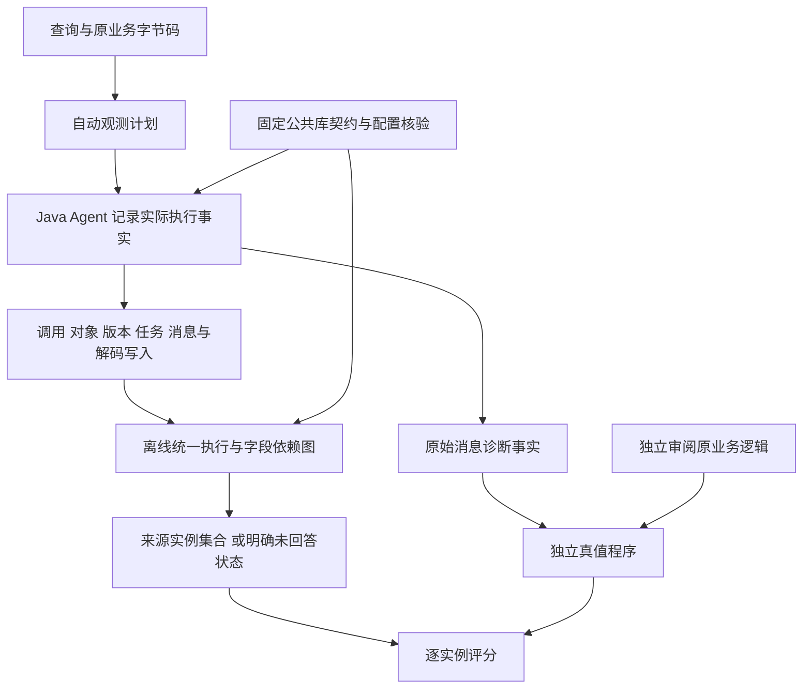

# 原版 Orders 来源链的有限端到端机制

本轮把原有执行依赖内核、任务/Future 配对与新的 HTTP/解码、保存效果契约组合起来。统一内核仍按字节码解释 Value、Frame、字段版本和容器状态；公共库用固定版本的可执行契约补充。算法没有为 customer.username 等业务字段写来源公式。本轮也不等于任意 Java、任意 Mongo 配置或任意异步共享内存的完整分析器。

## 计划、事实与依赖计算仍然分开

查询声明入口、目标路径和来源边界；本轮 12 个开发查询统一启用 execution_kernel、application_calls、async_dependencies，不按字段选择一个运行后恰好成功的 profile。静态阶段从原业务字节码生成调用图、读写、分支和目标绑定计划；两种观测模式保守保留本路径需要的证据，尚未做新增查询切片收缩。

Agent 在线记录实际对象、字段写入版本、调用生命周期、任务身份、消息及配置核验事实，不在线计算来源集合。Python 离线内核消费这些事实和原字节码，计算依赖并建立图。返回/序列化快照只绑定目标和核验一致性，不能创建来源。HTTP 原始字节旁路在本轮用于独立真值与诊断；算法来源来自实际解码输入写入，未把旁路原始字段自动注册为来源。

## RequestEntity 与实际 HTTP 响应

新增契约覆盖原应用实际使用的 RequestEntity.get/post、accept/contentType、build/body 和 RestTemplate.exchange(RequestEntity, ParameterizedTypeReference)，核对请求 URI、方法、body 身份、类型参数、实际响应包装及 RPC 坐标。固定 Spring 4.3.6、HATEOAS 0.20、Jackson 2.8.6 和 JDK 类哈希；检查实际 converter、默认异常处理器及有限传输/追踪拦截器配置。只出现相同字符串或相同 trace-id 不足以连接两个请求。

这是有限接口契约，不是把网络调用声明为只读。未知网络、日志等调用仍对可触及共享状态施加保守屏障。只有经固定默认 serializer、直接字节码 getter/字段投影核验的私有请求图，才可使用有限参数保持条件；自定义 serializer、未知 callback 或共享别名不取得这一证明。

## 解码写入决定来源，字段同名不决定来源

默认 Resource<T> 解码必须同时核验外层 Resource 的忽略属性、内层实际 BeanDeserializer、默认实例化器、setter 和具体 JavaType。新对象在实际解码区段的出生证据、构造字段写入计数与最终字段版本都需匹配。

| 实际情况 | 字段来源处理 |
| --- | --- |
| JSON 属性实际执行一个已核验 setter 写入 | 连接本次 HTTP 解码消息中该字段实例 |
| 属性缺失，保持核验过的默认 null、没有字段写入 | 已知空数据来源 |
| 属性显式为 null，但 setter 实际执行 | 来源为该实际输入字段，不能当作默认常量 |
| Resource 忽略 wire id，content.id 未写入 | 不连接 wire /id；符合默认条件才给空来源 |
| 同一字段重复写入或构造/解码行为无法解释 | 保留 unknown，不凭最后的值选来源 |

当前只支持固定的普通 DTO 标量和经检查的有限空列表结构。任意嵌套集合、自定义命名、混入、自定义实例化或属性转换不在该契约内。对这些情况拒绝/unknown，不能仅以“响应看起来像 DTO”接纳。

## 工作结果带回依赖，不重置来源边界

实际任务实例、worker Frame、内层 AsyncResult、FutureTask 和每次 get 继续使用原任务协议连接。重放工作 Frame 时使用同一个执行解释器，但独立 State，不复制父线程任意可变堆。明确不可变参数可以传递已有依赖；借用可变引用保留身份及 unknown。

本轮新增有限的“已核验新解码图”导出：Resource 包装到内容对象的引用及已解释字段版本可一次性导入父 State。导入依据实际新对象/解码写入，不依据 Future 或返回快照造源。重复 get 使用缓存，不能覆盖父线程后来的 setter、同值常量覆盖或未知失效。

私有性是接纳条件：对象经字段、包装或数组发布到共享对象后，后续不透明效果会保守失效相关字段。控制程序分别验证未发布私有对象与字段/数组发布，不能只因原对象值未变化而宣告来源保留。任意共享并发修改、任意任务嵌套和一般容器结果不由此取得保证。

## 保存按实际效果核验，不统一视为只读

有限保存契约核对原 SimpleMongoRepository/MongoTemplate/MappingMongoConverter、默认转换注册表、持久化字段映射、实际实体/返回身份以及事件发布器。默认注册表由不允许数据库访问的独立默认配置探针获得，不额外查询业务数据。

保存事件须使用固定同步 multicaster；实际监听器及派发均记录。原 Orders 的监听器列表并非空，但这组执行没有进入应用事件 handler，必须核对 handler 调用计数为零。自定义实体监听器、实际执行的 @EventListener、自定义 converter、非空 DBRef 或未解释映射仍为 unknown。不能将“没有发生 handler”偷换成“任何回调都安全”。

Mongo 原生生成根 String ID 时，Agent 记录实际字段写入及新版本；生成 ID 不伪装为原输入来源。其他目标字段只有在配置、映射、私有图、调用及字段检查共同成立时才保留依赖。前后数值相同、返回同一对象，都不是单独充分条件。Date 等未解释的可变状态仍失效；本轮不借此回答日期查询。

## 库回调也要绑定动态调用实例

List.toString/StringBuilder.append(Object) 等可能在一个尚未完成的调用内连续回调多个业务 toString。每个回调用当前尚未完成的父调用 frame、站点、call-id 绑定，不沿用第一个回调消费后的线程本地旧站点。成员对象及实际顺序另行核验；同值成员仍是不同实例。callback_lifecycle_version=2 的计划强制校验该调用 ID，旧计划按原协议复算，不伪造旧捕获缺失的新事件。

同一元素在渲染中被同值常量覆盖，会产生新字段版本及空来源；不是因为输出值相同就保留旧依赖。缺失回调、错误调用 ID/父 Frame、错误成员或完成配对仍拒绝。

## 两项监测器可靠性修复

并发对象 ID 分配和事件序列化加互斥保护，避免不同线程给不同对象分配相同 ID。事件只允许标量和元数据容器，内部业务对象引用在导出前剔除；拒绝发生在分配序号之前，不能为了写日志调用业务 getter 并递归写事件。16,000 个同值不同对象的并发压力控制验证身份唯一，独立 Sentinel 验证事件拒绝没有调用 getter。

诊断快照遇到必要但无法投影的对象，可记录身份与 snapshot_unsupported，不能把观测异常抛回业务。该对象的依赖仍不透明，不能用空快照认定空来源。

## 自动程度与边界

字节码产生应用方法传播，运行证据确定调用/版本，公共契约提供明确有限库语义；用户不逐个匹配来源实例。人工工作包括任务边界/查询配置、公共库契约审查及独立测试真值。后者从原代码、原消息和字段坐标判断预期来源，不进入算法实现。评价中的 [坐标规范化](normalize_orders_origins.py) 仅将同一实际解码输入的两种记录命名为相同坐标，不传播、补源或按数值挑源。

unknown、analysis_limited、evidence_invalid 与业务 N/A 继续分开。未解释的必要效果保持 unknown；完整证据下预算不足是分析限制；证据缺失/矛盾不伪装成不支持。保存/HTTP 全部配置通用化、自定义序列化和任意并发未实现。最终能力对齐仍需同一冻结版本重新运行全部 62 查询，不能拼接历次检查点声称总体准确率。

这条链只针对已声明标量目标闭合必要依赖。实际购物车列表任务及某些非目标计算仍可不透明；本轮不证明新内核能解释 newOrder 的全部字段或 calculateTotal。原复制、归约等快速路径保留，未把新内核设成全仓所有查询的默认替代；最终统一策略仍需全量验证。每查询使用哪个支持规则应在运行前确定，不能依据答案成功与否事后选路由。

实现：[请求与解码事实](RequestEntityHooks.java)、[保存效果](SaveEffectHooks.java)、[监测与调用闭合](ExecutionKernelHooks.java)、[离线解释](infer_application_execution.py)、[原业务驱动](run_orders_source_chain.py)、[复核](audit_orders_source_chain.py)。结果及保留失败见[本轮报告](ORDERS-END-TO-END-REVISION-20261021.md)。
