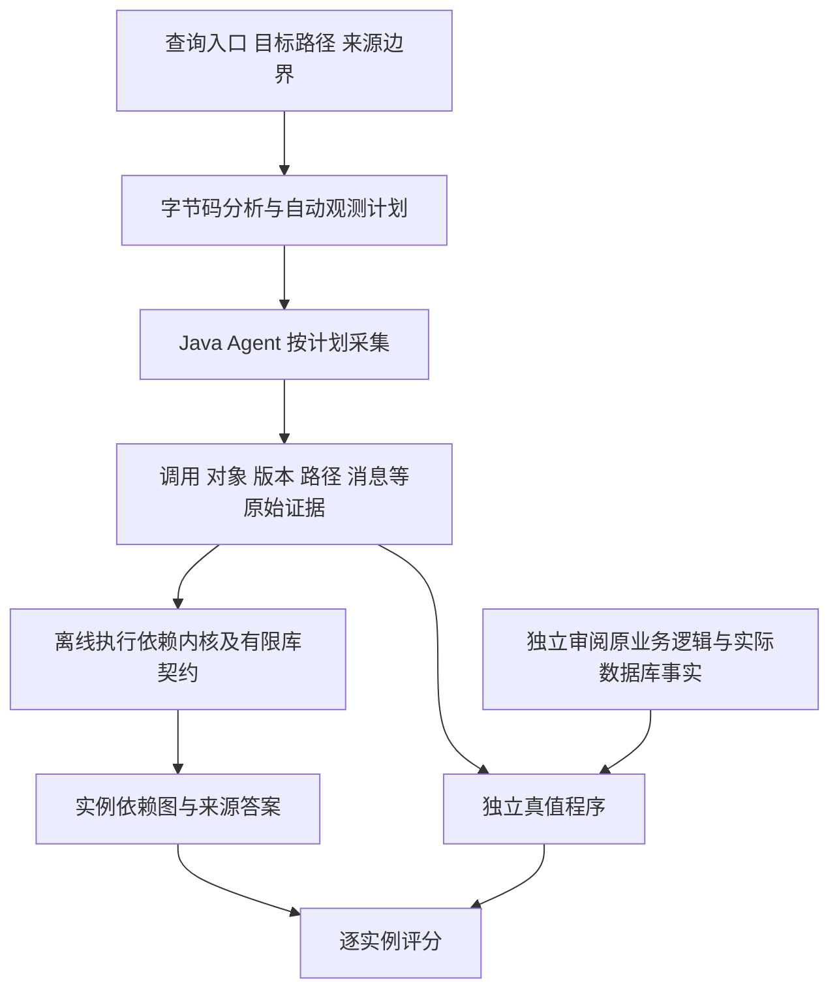

# TraceFusion 2：当前方法、结果与剩余工作

截至2026-10-22，当前算法冻结为`76d2050`。Java主线已从多个受限profile发展为“响应目标绑定＋统一执行依赖内核＋有限公共库契约”，保留原有快速路径。最新原生Jackson环境下，62个已暴露查询、431个目标，full/selective各428正确、3unknown、0错误确定答案；本轮另完成三类任务45次固定负载成本部署。

这是声明边界内的自动来源还原，不需要用户手动逐个匹配来源实例；人工仍需声明查询入口、目标字段/路径和来源边界，并审查公共库契约。当前实现与实验主要针对Java，不宣称任意程序、任意库和任意语言都能直接接入。

## 当前算法怎样工作

1. **运行前规划。** 读取原业务JAR字节码，将响应JSON路径绑定到实际返回对象、包装、字段、列表元素或Map条目；依据目标结构和支持条件选择专用复制/归约/集合/标量/转发证明，或统一执行内核。控制流定义集合在汇合和回边合并到有限不动点，不靠枚举所有循环路径；不根据执行答案挑profile。
2. **在线采集事实。** Java Agent按计划记录实际调用Frame、实参/返回、对象身份、字段写版本、分支/循环、构造和容器操作、异常完成，以及必要RPC、解码、任务/Future和保存效果。在线不计算完整来源集合。Agent内部Jackson已迁入私有包，业务使用自身原版库。
3. **离线解释执行。** 统一Value/Frame/State/Call/Container状态按原字节码和实际路径解释栈、局部变量、字段、数组及有限集合语义；非递归应用调用通过实参、共享字段状态、返回和异常传递依赖。必要库调用必须满足固定版本及可执行检查，不透明调用对可能受影响的结果/字段保守失效。
4. **跨服务与异步连接。** RPC使用W3C上下文、具体span、方向和JSON路径；来源连接还核对实际解码写入、对象和版本。私有任务、worker Frame、完成结果和Future.get按实例配对，不能只凭trace-id或相同数值连接。保存按实际改写、配置、监听器和编码器核验，不统一视为只读。
5. **回答或明确未回答。** 从目标实例反向查询到声明的入口、实际仓储返回、RPC字段边界。返回/序列化快照只绑定目标，不创建来源。必要语义不明为unknown；预算耗尽为analysis_limited；必要证据缺失/矛盾为evidence_invalid；业务未产生目标为N/A。已知空来源与unknown严格分开。

同值不同对象、同一方法重复调用、同一字段多次写入以及列表重复值均使用实例坐标区分。分支、索引和过滤保留选择证据，当前表中的数据来源不混入一般隐式控制流。来源从声明边界开始，不追数据库完整写历史；时间生成在字段输入边界上可为空，不等于环境时间是常量。

两个实际案例说明身份与契约检查的作用：HATEOAS线上id非空，但默认解码忽略该属性，content.id仍为null，不能按同名JSON路径补源；Cart首次GET与再次GET返回相同customerId，却必须依据本次实际仓储读取区分来源。保存返回同一个对象，也不能单凭身份或前后值相同证明所有字段保持来源。

字节码分析、采集器和离线计算在执行阶段上分开，但当前规划器和解释器仍含JVM语义。图、实例坐标和消息协议具有复用空间；换语言仍需相应前端、采集适配和语义验证。仓库已有Go/C/eBPF早期原型，不能与本页Java结果合并成统一多语言正确率或成本结论。

## 最新正确性与基线能力

| 同一固定评估范围 | 当前TF full | 当前TF selective | 历史MirrorTaint＋披露适配器 |
| --- | ---: | ---: | ---: |
| 实际目标 | 431 | 431 | 431 |
| 独立实例来源完全匹配 | 428（99.30%） | 428（99.30%） | 368（85.38%） |
| 错误确定答案 | 0 | 0 | 35 |
| unknown／未能回答 | 3 | 3 | 28 |
| 关系TP / FP / FN | 397 / 0 / 3 | 397 / 0 / 3 | 337 / 14 / 63 |

TF的62查询来自两个应用18个入口，当前全部规划接纳；每模式388次查询请求、431个目标，另85个查询请求N/A。Sock Shop128/131正确、3unknown，Train Ticket300/300。31个正确目标为空数据来源，因此关系TP不等于目标数。full/selective逐项431/431状态一致。

当前TF逐项保留原MirrorTaint正确368/368、旧TF正确213/213及两者联合382/382，已满足原先定义的联合能力验收。MirrorTaint列是原固定任务中保留的历史独立评分，本轮没有重新运行基线；不能据此对其任意配置或所有能力排名。也不能把“已知答案428/428匹配”写成“431/431全部可回答”。

最后3个unknown是Cart首次新建商品的itemId、quantity、unitPrice，涉及尚未闭合的监听器/工厂、保存/DBRef及接收容器修改效果；来源边界没移动，未按同值补来源。这3个在原MirrorTaint配置中也未回答，不妨碍原368正确实例保持，但仍是TF自身能力边界。

隔离后同一Agent重新部署的历史跨服务回归：Sock Shop198/198、TP258；Train Ticket Station31/31、TP30，FP/FN/unknown均0。它们与431集合存在重叠，不相加成总体准确率。语义及负控制包括同值身份、重复调用、循环成员、写版本、数组/lambda、异步、保存、Date/UUID、真实转换及缺失/歧义证据；预期unknown单独报告。

## 自动规划与未见查询：证据到哪里

原候选池Sock Shop37＋Train Ticket54＝91。最初冻结版对预选新查询0/20接纳，负结果永久保留。后续响应绑定冻结版在Train Ticket封存新入口10/12查询族接纳、71/71实际目标正确；Sock Shop同轮8/10接纳但24个目标全unknown。再后续有限模型封存测试的可回答率为Sock Shop6/24、Train Ticket35/49，已知答案分别6/6和35/35匹配，Basic批次证据问题单列保留。

这些封存查询一旦用于后续开发，就成为回归集。今天的428/431是62个已暴露查询的统一版本复验，不能重新称为未见泛化。剩余29个候选仍封存；当前新版尚需冻结后的新查询首次验证，才能判断开发集外的覆盖。

## 当前版本新性能结果

三类任务各五轮原版/full/selective、45次独立部署；预热30秒、测量60秒，2请求/秒、并发上限2。统一业务JVM/资源限制，保留全部必要证据及原始HTTP审计字节。原版没有来源输出。下表均为五轮配对比值中位数变化；完整绝对值、范围、各阶段与逐轮数据见[新版成本报告](ISOLATED-COST-20261022.md)。

| 任务 | full/selective各自正确目标 | selective相对原版p95 | selective相对原版CPU | selective/full测量请求字节 | selective/full离线核心 |
| --- | ---: | ---: | ---: | ---: | ---: |
| Cart读取，新内核 | 1350/1350 | +37.82% | +103.43% | -0.61% | +4.17% |
| Train返回绑定 | 900/900 | +18.90% | +27.57% | -7.83% | -15.67% |
| 五服务票价计算 | 1800/1800 | +22.49% | +46.39% | -27.56% | -60.01% |

三任务分别解释，不合并成一个速度提升数字。每配置900次请求，其中300预热、600测量；在线性能排除预热，来源正确性检查全部调用。两种模式都正确不等于都有记录量收益，新内核的查询切片收缩仍未完成。低负载结果不说明最大吞吐；小样本范围不是总体显著性证明，答案等待主要含批处理窗口。

## 历史外部成本与严格消融

2026-10-15共同Orders.total任务，TF与MirrorTaint精简原生来源输出＋适配器各900/900正确；五轮固定2请求/秒下TF相对MT的配对中位数：p95−43.89%、业务JVM CPU−31.77%、采集字节−50.50%、离线核心−50.20%。这是`8a92bf4`历史配置证据，事件数反而略高0.34%，不能把字节差全归因于事件更少。它不是`76d2050`的新外部成本比较。Phosphor/FlowDist尚无本次同实例任务资格校准，相关排名及成本保持N/A。

早期内部full/selective消融在相同采集/还原体系内已显示减少记录与离线负担：Sock Shop total事件−80.37%、字节−63.03%；Train Ticket票价事件−52.92%、字节−32.57%。当时在线CPU分别+8.36%、+1.10%，没有支持所有在线成本全面改善。后续`2b3b929`三任务成本也保留；这些数字不移用于当前版本，当前应引用上表新测量。

## 安全应用与早期原型

Log4j受控验证已完成，未在本轮重复：22个跨服务日志泄露查询为TP9/FP0/FN1/TN12，一个必要helper未知按漏检计，Recall90%。漏洞配置Log4j2.14.1、缓解配置、修复版2.17.1各5例；前者3触发＋2负例，后两组均不触发本组lookup。证据是实际日志参数、JNDI参数和本地无害回调；没有LDAP、远程加载或RCE。真实Solr只有源码预检，运行结果N/A。37个业务调用通过不等于37个来源查询全部正确。

Go/C二进制及eBPF原型、Gin请求/线程迁移、checkout金额链与早期Galette/libdft64比较保留在各自报告。本轮未重跑，不与Java对象实例任务、不同机器的绝对成本或安全判据混算。

## 目前可以主张与下一步

当前可主张：在已声明的Java/框架/库契约和字段边界内，自动生成观测计划并按实际执行恢复实例来源；固定62查询上覆盖了历史基线的全部正确实例，且没有错误确定答案；新成本由本轮单独测量，选择性收益应逐profile、逐任务解释。

仍不能主张：任意Java/多语言通用完备、431/431全部可回答、所有查询无需人工公共模型、当前新版普遍比所有基线便宜，或开发集428/431证明了未见查询泛化。递归、任意反射/native、共享并发修改、自定义序列化和任意库效果仍有边界。

下一步优先：在核心冻结后按原协议启封剩余29候选，完整保留拒绝/unknown/N/A/无效与独立真值；再依据本轮不同profile的成本结果决定新内核的查询切片收缩。最后3个Cart目标如继续扩展，须用有限可核验效果补齐并另行冻结，不能用白名单抹除未知。新增外部成本排名须先重校准当前共同任务。

## 复核入口

- [当前依赖隔离与431目标验收](JACKSON-ISOLATION-20261022.md)，原始工件artifacts/jackson-isolation-20261022/candidate-v2/。
- [本轮成本与逐轮范围](ISOLATED-COST-20261022.md)，原始工件artifacts/isolated-cost-20261022/，包含冻结协议、45部署、真值/预测、原库哈希、阶段计时、内存复算与规划成本。
- [原431目标基线对照](BASELINE-CAPABILITY-20261020.md)、[首次0/20](QUERY-COVERAGE-20261019.md)、[封存绑定验证](RESPONSE-BINDING-REVISION-20261019.md)。
- [历史外部比较、消融、安全证据索引](PAPER-EVIDENCE-20261016.md)，按各自版本引用。

代码和小型摘要在main提交，所有push由用户完成。完整artifacts与Docker镜像不随Git同步；备份入口artifacts/isolated-cost-backup-20261022/START-HERE.txt。归档是同盘恢复副本，迁移仍须按digest准备镜像、在新目录重建，不能盲用旧绝对路径。
