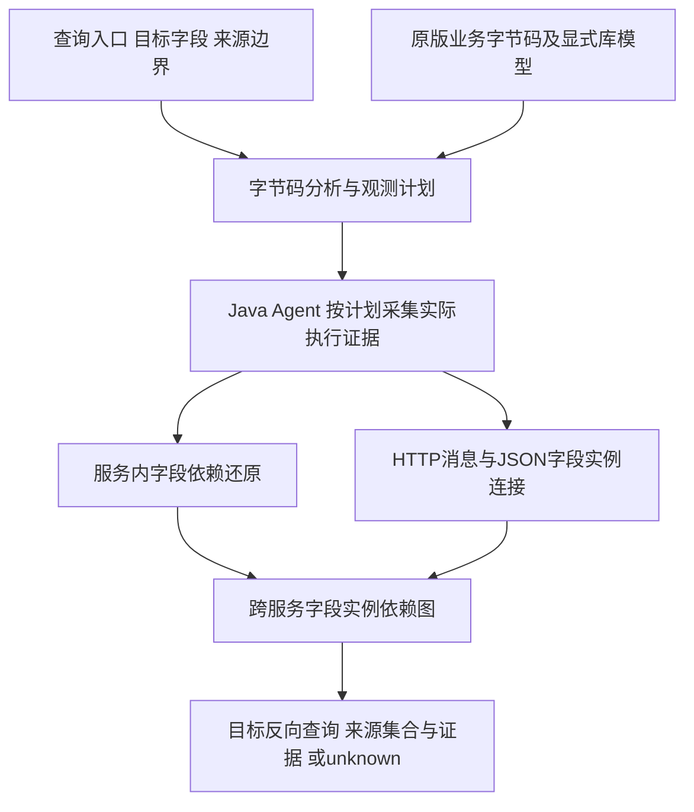

# TraceFusion 2 方法与实验进展

2026-10-19补充：已完成[响应目标绑定修订与封存测试](RESPONSE-BINDING-REVISION-20261019.md)，
最新算法详见[有界响应绑定说明](RESPONSE-BINDING-ALGORITHM-20261019.md)。冻结核心803b92f在Train Ticket
新入口接纳10/12查询、71/71实际目标来源完全匹配；Sock Shop旧入口新字段虽接纳8/10计划，
实际24个目标全部unknown。原0/20负结果保留，旧20查询已成为开发集。下文保留10月16日历史实验口径，
成本结果不能直接移用于本修订版。

TraceFusion 2 研究如何从指定输出字段出发，自动规划运行时需要保留的证据，再还原该字段在本次执行中的跨服务来源。当前实现结合字节码分析、选择性 Java Agent 观测和离线字段实例依赖图。

截至2026年10月16日，已在 Sock Shop 和 Train Ticket 的选定真实业务路径上完成字段来源验证、外部工具比较与选择性观测消融。当前结果支持：**针对指定字段查询，可以减少运行观测记录和离线处理负担，并保持已验证查询的来源答案。** 内部消融尚未显示在线 CPU 改善。

2026年10月19日补充的冻结后新查询覆盖实验发现：从两个应用预先建立的候选池中各选10个新目标，当前规划接口均拒绝，显式集合profile也没有增加接受查询。四个历史查询规划正控制仍通过。因此，“自动规划”的结论应限于当前支持形态，不能从此前选定路径成功推断对新目标具有广泛覆盖。完整结果见下文及[独立覆盖报告](QUERY-COVERAGE-20261019.md)。

## 研究问题

我们关注的是：一个输出字段在本次执行中实际使用了哪些输入字段？例如，订单总额来自购物车中哪些数量和单价，票价来自哪次服务响应中的距离元素与费率。

算法输入是原版业务字节码、查询入口、目标字段及来源边界；输出是某次执行中该目标字段的来源实例集合和可追查的证据图，或者明确的 unknown / N/A。业务使用原版 JAR，运行时通过 Java Agent 插桩。

## 最新算法如何工作

算法分为**查询驱动的静态观测规划、运行时证据采集、离线实际执行还原**三个阶段。静态阶段给出保守候选，动态证据确定实际发生的调用、分支及对象实例，离线阶段计算来源集合。



### 从目标字段反向生成观测计划

先提取方法指令、调用、字段读写、控制流及异常表，确定哪些写入可能产生目标字段，再沿定义与使用关系反向寻找所需计算、读取和调用。当前实现按支持的语义分别处理字段复制、映射归约与集合计算；不能把某一类支持扩展理解为任意方法都能分析。

最新的集合计算规划器使用工作表传播操作数栈与局部变量的可能定义，在控制流汇合点合并定义集合，避免枚举所有完整分支路径。它从目标 setter 调用做反向依赖闭包，并为本地 Map、StringBuilder 分配补入可能影响其内容的操作，防止漏掉“返回值未直接使用、但修改了容器内容”的调用。局部可变对象流入无法解释的调用会被拒绝。

输出计划明确列出需要观测的调用位置、字段、根调用、分支、异常入口及通信结构。集合 profile 保守保留根方法分支；计划不保证最小。该 profile 当前只接受有界无环方法及支持的指令、类型和调用契约。

### 记录能区分实际执行的证据

Agent 按计划记录调用帧、对象身份、字段读取与写入计数版本、实际分支和异常处理入口；集合计算还记录选定调用的接收对象、参数、返回值及集合内容。HTTP/JSON、必要的转换事件与版本维护也有公共观测成本，并非只剩几个选中的调用。

字段实例由服务、对象、字段与已观测版本等坐标区分。列表元素使用容器身份、下标和观测内容阶段，Map 使用容器身份、键及观测阶段，避免相同值或 Java 装箱对象复用造成来源混淆。集合阶段只表示被观察到的内容状态，不代表任意未观测修改的完整历史。

接收集合的只读契约通过已覆盖修改调用的运行时检查与内容核对保护；这不覆盖任意反射/native写或并发共享修改。

在线阶段记录证据，来源集合在离线阶段计算。来源关联依赖具体身份与调用坐标，数值用于一致性检查。

### 按实际路径还原服务内计算

离线端先检查事件连续性、采集关闭状态、计划哈希与通信协议，再依对应 profile 还原局部依赖。复制路径校验实际读、参数传递和写入身份；归约路径结合标量表达式、实际输入及归约证据；集合路径按原始根方法字节码和观测到的分支、异常入口重放当前支持的操作。

集合重放为中间值维护来源与选择证据，并维护本地 Map、StringBuilder 状态。例如，在当前数据依赖语义下：

- 常量的来源集合为空；已识别字段或列表元素产生其具体实例来源。
- 支持的算术运算合并实际操作数的来源；乘以0或相减得0仍保留参与计算的来源。
- `List.get` 的数据来源是实际选中的元素，索引的来源另作选择证据；同值元素仍按位置区分。
- 本地 `Map.put` 更新对应键的状态，后写覆盖前写；StringBuilder 按实际追加顺序累计内容依赖。
- 调用抛异常时，只有原异常表与实际 handler 证据一致，才能转入对应回退路径。

分支和索引用于确定执行及选择，但当前价格查询不把这些选择字段混入数值操作数来源，也不声称一般隐式流分析。

### 连接跨服务字段实例

通信层使用 W3C traceparent/tracestate，并结合具体 RPC span、请求或响应方向、JSON pointer 对齐发送与接收字段；同一 trace 下不同消息不会只凭 trace-id 合并。服务内通过已核验的对象、字段、版本关系，将计算输入接回实际反序列化字段，将结果接到实际序列化字段。

对于 Map 经 JSON 转成 DTO 等转换，使用显式声明并核对实现版本的库摘要，按具体转换调用及相对 JSON 路径连接输入输出。当前 `JsonUtils.conveterObject` 摘要是人工审查的默认 Jackson 行为契约，不能泛化为所有序列化配置的自动证明。

这些局部计算边、对象字段连接边和通信边组成统一依赖图。从具体响应字段反向遍历，直到声明的来源边界，得到来源实例及解释路径；不读取测试预期答案，也不写入业务价格公式。

### 对无法支持的情况保留明确状态

必要的未建模调用把不透明值带入目标时，答案保持 unknown；缺失或矛盾的必要证据、无法唯一连接的消息等会导致校验失败或无法确定，不按相同数值猜选来源。业务未生成目标字段时单列 N/A。已确认的常量回退可给出已知的空来源集合，不能将未知依赖当作空来源。

当前能力依赖受支持的字节码、具体库类型与已声明的契约。一般循环、任意共享可变集合、反射/native写和自定义序列化等仍超出保证。

### 以真实票价路径说明算法输出

Train Ticket 正常价格路径可概括为以下原业务计算；该式用于解释实例，不作为还原器内置规则：

```text
价格字符串 = 字符串转换((distances[end] - distances[start]) × rate)
```

目标是响应中的价格 Map 条目。规划器从目标写入反向选择 Map.put、字符串构造、数值运算、List.get 及所需 getter；运行时记录本次 start/end、实际容器和 RPC。离线按原字节码重放，将两个实际距离元素和对应费率连回各自服务响应。

即使两个距离值相等、两项费率相同，来源仍是不同的元素/字段实例；若实际进入返回固定价格的 catch，则该目标的数据来源为空。选择了哪个站点和索引的证据另存，不能把这个查询解释成所有控制依赖都已追踪。

### 当前算法贡献与实现入口

核心是将**指定字段查询到观测计划的生成、实际执行的身份与路径证据、跨服务字段实例还原**连接起来，并用同答案消融评估减少观测的收益。新增集合 profile 通过定义合并、可变对象效果闭包和按实际路径重放，扩展了原有复制与映射归约能力；并未替换全部旧 profile，也未证明对任意程序的完备性或全局最小观测。

实现可从[构建与profile选择](build_distributed_plans.py)、[原有归约规划](plan_service_observations.py)、[复制规划与通信结构](plan_distributed_fields.py)、[集合规划](plan_collection_service.py)、[集合观测](CollectionServiceHooks.java)、[集合重放](infer_collection_service.py)及[统一依赖图与来源查询](infer_distributed_fields.py)查看。下面的实验分别检验这套方法的正确性、共同任务成本及选择性观测贡献。

## 冻结后的新查询覆盖

| 应用 | 候选查询 | 预先选中 | 默认/加入显式profile后接受 | 拒绝 |
| --- | ---: | ---: | --- | ---: |
| Sock Shop | 37 | 10 | 0 / 0 | 10 |
| Train Ticket | 54 | 10 | 0 / 0 | 10 |

算法、原版JAR、依赖与配置在选池前冻结；候选和确定性服务轮转选择在规划前提交，没有按成功结果换查询。失败主要来自仓储/嵌套对象转发缺少当前局部写入绑定，以及循环、指令和路径界限。集合profile对没有Map结果修改的独立目标也可能拒绝。原实现和库摘要均未修改。

因为没有接受计划，本轮没有强行运行拒绝查询；运行后可回答率、已知答案准确率均为N/A。0/20是所选新查询的规划接受结果，不是运行错误率，也不证明原还原器在已有宽观测日志下必然无法回答这些字段。其余71个候选未测试，不能外推。候选由本项目审阅原程序建立，部分字段曾作旧实验的输入，尚非第三方盲测。

## 已选路径的正确性结果

“完全匹配”指目标字段来源集合及声明的实例坐标与独立真值一致；来源关系 TP 与字段查询数量是不同分母。

| 实验 | 字段查询完全匹配 | 来源关系 TP / FP / FN |
| --- | ---: | --- |
| Sock Shop 原有选定路径，新核心回归 | 198/198 | 258 / 0 / 0 |
| Train Ticket Station 路径，新核心回归 | 31/31 | 30 / 0 / 0 |
| Train Ticket 多来源价格路径，冻结后新输入 | full、selective 各38/38 | 各92 / 0 / 0 |
| Train Ticket 同路径五轮成本实验 | full、selective 各1800/1800 | 各4330 / 0 / 0 |

新价格路径使用原版五个业务服务，包含距离列表索引差、费率乘法、字符串转换和异常分支。20个校准请求中，一个上游失败导致价格未生成，两个目标单列 N/A；另外19个请求产生38个字段查询。正式性能负载预先排除该未产目标模板。实现与规则冻结后生成测试输入，但用例结构由本项目设计，尚非第三方盲测。

这些结果只覆盖选定路径与声明来源边界，不代表整个应用或任意输入均无误；各实验存在重叠路径，不合并为一个总体准确率。

## 与 MirrorTaint 的共同查询比较

共同任务为购物车实际响应字段到 `Orders.total` 的来源查询。两方先校准，再执行五轮随机配置顺序、独立部署实验；每次预热30秒、测量60秒，固定2请求/秒、最大并发2，相同业务 JVM 参数和资源限制。两方各900/900查询完全匹配，TP3750，FP/FN及目标 unknown 为0；其中300次请求用于预热、600次用于性能测量。

MirrorTaint 使用原作者 JAR，并配置已披露的跨服务/实例适配器、信息诊断关闭适配和原生来源标识导出；原生传播未改。以下是 TF 相对该配置的五轮配对比值中位数，不能扩展为对工具全部能力的排名。

| 指标 | TraceFusion 相对 MirrorTaint |
| --- | ---: |
| 在线 p95 延迟 | 降低43.89% |
| 在线业务 JVM CPU | 降低31.77% |
| 采集字节 | 减少50.50% |
| 离线核心处理时间 | 减少50.20% |
| 离线子进程峰值 RSS | 减少5.93% |

本比较已使用精简输出配置，主结果不依赖旧版大量诊断日志。TF 的事件数量反而略高0.34%，因此跨工具字节差不能简单归因为事件更少。Phosphor、FlowDist 有较早不同口径实验，但尚未校准本次共同字段实例成本任务，本比较中保持 N/A。

## 内部消融区分了选择性观测的贡献

每个应用内部，full 和 selective 使用相同采集器、事件格式与离线还原器，只改变观测策略，保持当前查询答案。full 限于纳入分析的应用类和根调用范围，并非整个 JVM 的所有指令。

| selective 相对 full，五轮配对变化 | Sock Shop total | Train Ticket 价格 |
| --- | ---: | ---: |
| 采集事件 | −80.37% | −52.92% |
| 采集字节 | −63.03% | −32.57% |
| 离线子进程墙时 | −66.91% | −54.27% |
| 离线子进程 CPU | −67.51% | −54.80% |
| 离线子进程峰值 RSS | −54.61% | −13.53% |
| 在线业务 JVM CPU | **+8.36%** | **+1.10%** |

两应用均支持减少记录和离线负担，在线 CPU 未见改善。在线 p95 的配对点估计分别为−7.04%和−3.46%，但五轮比值范围均跨1，不称稳定降低。相对无来源输出的原版，Train Ticket selective 配置的 p95 延迟增加11.60%、业务 JVM CPU增加29.82%，观测仍有实际成本。

## Log4j 安全验证已完成

已完成22个受控跨服务日志泄露查询，以及 Log4j 漏洞配置、缓解配置、修复版各5个用例。泄露查询为TP9、FP0、FN1、TN12；其中一个未建模 helper 保持 unknown，并按阳性漏检计入FN，Recall为90%。

Log4j 2.14.1 漏洞配置的三个触发例和两个负例符合预期，缓解配置与2.17.1修复版均未触发本组 lookup。证据连接实际日志参数、原生 JNDI lookup 参数及本地无害回调标记；没有访问 LDAP、远程加载或执行 RCE。这是受控验证，真实 Solr 应用目前只有源码预检。

## 结论边界与希望讨论的问题

当前主要证据限于 Java 字段来源主线、指定查询及明确模型。来源从声明的实际响应/实体边界开始，不覆盖数据库完整历史；Train Ticket 的来源关系只计数值操作数，索引与分支选择证据另存，不声称一般隐式控制流。任意共享可变集合、反射/native写、自定义序列化和一般循环超出当前保证。

性能结果来自同一机器各五轮部署配对，属于小样本固定负载结果，不宣称统计显著、最大吞吐或跨机器普适优势。离线时间针对整批预热与测量数据；约一分钟的批次答案等待含剩余窗口及关闭采集流程，不能作为工具固有流式延迟。

希望重点讨论：是否应将贡献限定为当前支持形态内的自动观测与实例还原，还是另设版本修复新查询入口；共同查询和适配器披露是否足以支撑公平比较；现有两个真实应用加受控安全实验是否覆盖了拟主张的适用范围。首轮新查询拒绝结果必须保留，后续修复与回归另行报告。

详细数字、五轮范围、冻结版本、原始工件及复算脚本见[论文结果与证据清单](PAPER-EVIDENCE-20261016.md)。代码与小型摘要随Git保存，完整实验数据和Docker镜像需另外准备。
