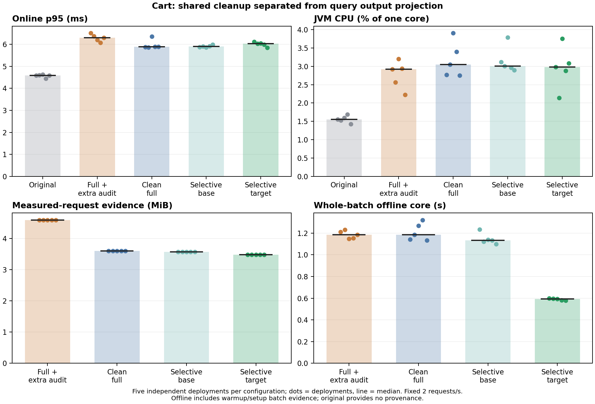

# 传输观测收缩：Cart五轮独立成本消融

算法冻结 `e78cc04cd1319ed8a7cd28c1441b261a04715cca`。五配置各五轮，25次独立部署，随机顺序；全部使用本批新数据。每轮预热30秒、测量60秒、2请求/秒、并发2，JVM32/256MiB、GC1/CI2，业务1CPU/768MiB，Mongo1CPU/384MiB。原始HTTP审计开关保留。

full_legacy同样使用当前冻结代码，仅关闭公共清理和字段投影；它不是旧二进制版本。本表没有使用旧版性能数字。
full与selective共同取消绑定服务端响应上不被还原器消费的出站请求证明，必要出站请求证明保持。full_legacy仅作旧工程审计参照，公共清理收益不归为查询选择性贡献。selective_base与selective仅相差目标响应字段持久化投影；完整前后快照仍保留，临时字段采集没有减少。来源、调用、分支、构造、写入、异常和目标序列化检查均保留，没有格式压缩或通用指令/调用切片。

每个来源配置900次请求（300预热、600性能测量），1350/1350目标来源正确，TP1350、FP/FN/unknown0。原版无来源输出，相应能力/离线成本N/A。稳态字节使用关闭后的完整记录按实际消息/Frame归属计算，文件可见窗口另存。

| 指标（五轮中位数） | 原版 | full保留旧证明 | 清理后full | 清理后selective，不投影 | 清理后selective＋投影 |
| --- | ---: | ---: | ---: | ---: | ---: |
| 在线p50，ms | 4.052 | 5.462 | 5.250 | 5.195 | 5.237 |
| 在线p95，ms | 4.585 | 6.302 | 5.885 | 5.906 | 6.029 |
| 在线p99，ms | 5.243 | 11.708 | 9.145 | 9.798 | 6.759 |
| 完成吞吐，rps | 2.000 | 2.000 | 2.000 | 2.000 | 2.000 |
| 错误率 | 0.000 | 0.000 | 0.000 | 0.000 | 0.000 |
| 业务JVM CPU，单核% | 1.555 | 2.919 | 3.053 | 3.007 | 2.981 |
| 业务平均RSS，MiB | 267.577 | 276.341 | 275.708 | 277.191 | 274.232 |
| 业务采样峰值RSS，MiB | 268.781 | 281.250 | 276.945 | 281.758 | 276.348 |
| 整部署CPU，单核% | 1.802 | 3.167 | 3.297 | 3.257 | 3.237 |
| 整部署平均RSS，MiB | 330.075 | 338.603 | 338.196 | 339.803 | 336.681 |
| 整部署采样峰值RSS，MiB | 331.262 | 343.535 | 339.113 | 344.438 | 338.898 |
| 稳态事件 | 0.000 | 8160.000 | 8160.000 | 8040.000 | 8040.000 |
| 稳态原始字节，MiB | 0.000 | 4.587 | 3.600 | 3.572 | 3.482 |
| 整批原始字节，MiB | 0.000 | 11.069 | 9.538 | 9.478 | 9.340 |
| 整部署控制台，MiB | 0.064 | 0.064 | 0.064 | 0.064 | 0.064 |
| 整批离线核心，秒 | N/A | 1.186 | 1.185 | 1.133 | 0.592 |
| 离线子进程墙时，秒 | N/A | 2.640 | 2.688 | 2.564 | 1.994 |
| 离线子进程CPU，秒 | N/A | 2.592 | 2.646 | 2.523 | 1.967 |
| 同批复算VmHWM，MiB | N/A | 98.223 | 93.293 | 92.938 | 86.984 |
| 完成至批次答案p50，秒 | N/A | 32.431 | 32.472 | 32.366 | 31.848 |
| 完成至批次答案p95，秒 | N/A | 59.431 | 59.472 | 59.365 | 58.848 |

| 顺序消融配对变化 | 公共清理 full/旧full | 读取位点 selective_base/full | 输出投影 selective/selective_base | 严格selective/full | 严格比较逐轮范围 |
| --- | ---: | ---: | ---: | ---: | --- |
| 在线p50，ms | -3.32% | +0.10% | -0.49% | -0.65% | 0.9812–1.0092 |
| 在线p95，ms | -6.56% | +0.45% | +2.08% | +1.61% | 0.9495–1.0395 |
| 在线p99，ms | -21.89% | +7.13% | -9.72% | -25.63% | 0.6696–1.6065 |
| 完成吞吐，rps | +0.00% | +0.00% | +0.00% | +0.00% | 1.0000–1.0000 |
| 业务JVM CPU，单核% | +18.91% | -1.48% | -2.82% | -3.72% | 0.7007–1.1206 |
| 业务平均RSS，MiB | +0.84% | +0.87% | -2.51% | -0.54% | 0.9372–1.0148 |
| 业务采样峰值RSS，MiB | +0.78% | +0.79% | -2.76% | -0.22% | 0.9367–1.0065 |
| 整部署CPU，单核% | +17.06% | -1.21% | -2.81% | -3.67% | 0.7238–1.1113 |
| 整部署平均RSS，MiB | +0.65% | +0.72% | -2.03% | -0.45% | 0.9489–1.0131 |
| 整部署采样峰值RSS，MiB | +0.67% | +0.62% | -1.83% | -0.06% | 0.9488–1.0058 |
| 稳态事件 | +0.00% | -1.47% | +0.00% | -1.47% | 0.9853–0.9853 |
| 稳态原始字节，MiB | -21.53% | -0.77% | -2.50% | -3.25% | 0.9672–0.9675 |
| 整批原始字节，MiB | -13.83% | -0.63% | -1.46% | -2.07% | 0.9790–0.9793 |
| 整部署控制台，MiB | -0.00% | +0.00% | +0.00% | +0.00% | 0.9999–1.0001 |
| 整批离线核心，秒 | -3.89% | -5.40% | -48.01% | -49.63% | 0.4404–0.5240 |
| 离线子进程墙时，秒 | -1.86% | -6.82% | -22.51% | -25.54% | 0.6559–0.7767 |
| 离线子进程CPU，秒 | -1.58% | -6.94% | -22.34% | -25.44% | 0.6568–0.7774 |
| 同批复算VmHWM，MiB | -5.02% | -0.23% | -6.41% | -6.62% | 0.9306–0.9350 |
| 完成至批次答案p50，秒 | -0.03% | -0.32% | -1.59% | -1.82% | 0.9787–0.9851 |
| 完成至批次答案p95，秒 | -0.02% | -0.17% | -0.86% | -0.99% | 0.9883–0.9919 |

变化是同轮配置比值的中位数，不以汇总中位数相除替代。各消融为条件于参照配置的顺序差异，不相加百分比；公共清理不计入严格选择性收益。不把每次部署内请求当独立重复；5轮仅描述点估计和范围，不宣称显著性、最大吞吐、跨机器普适优势。每轮仅120个测量请求，p99仅描述。

离线处理整批预热、测量与准备证据；核心、评分和导出分别存阶段时间。VmHWM为在线全部结束后20份相同证据的fresh-exec复算，原始墙时/CPU未改写，保留受fork高水位影响的原ru_maxrss。批次答案等待包含剩余采集窗口及关闭流程，不是流式算法固有延迟。当前没有新MirrorTaint成本校准，外部工具本表N/A；旧76d2050成本不填入本表。

## 静态规划与离线阶段

Cart五次新进程规划固定逻辑CPU 0，生成计划均与实际部署一致。流程墙时中位数0.3687秒，含解释器启动的子进程墙时0.4308秒，CPU 0.3994秒，15ms采样的进程树RSS峰值90.70MiB，纯计划分析7.023ms。OS页缓存未清空，进程树共享页可能重复计数，Agent编译和部署启动排除。

| 整批离线阶段（五轮中位数，秒） | 清理后selective＋投影 | full保留旧证明 | 清理后full | 清理后selective，不投影 |
| --- | ---: | ---: | ---: | ---: |
| JSON解码 | 0.085454 | 0.094231 | 0.087567 | 0.086246 |
| 验证/图构建/还原 | 0.585707 | 1.170760 | 1.168282 | 1.117930 |
| 目标来源查询 | 0.006742 | 0.014966 | 0.014990 | 0.015274 |
| 答案导出 | 0.008098 | 0.008227 | 0.008230 | 0.008159 |
| 独立真值评分 | 1.203352 | 1.230815 | 1.238824 | 1.211234 |
| 评分证据导出 | 0.028347 | 0.039091 | 0.039611 | 0.038984 |

完整环境、镜像ID/digest、命令、冻结配置和每轮原始数据保存在`artifacts/transport-cart-cost-v3-20261023`；运行入口为run_transport_cart_cost.py，审计入口为audit_transport_cart_cost.py。能力验收门槛及配置/源码哈希在config.json中固定，任何正式部署前均再次核对。逐轮表见[CSV](transport-cart-cost-deployments-20261023.csv)，阶段原值见各部署offline.json。

## 图工作量解释

整批图节点中位数：full 2857、selective_base 2857、selective 2020。来源边界节点均1386、执行结果节点均279、依赖边均558；相差837个非目标响应节点。此处包含准备/预热，不作为额外评分目标。

当前infer_distributed_fields.py的alias会为非目标序列化字段重复扫描binding-return记录。字段输出投影减少了这些非目标节点及连接工作，分阶段结果与这一结构相符；未单独剖析该函数的时间占比，不能把3.25%字节缩减解释为执行重放本身快一倍，也不能假定该比例适用于索引优化后的还原器。复算脚本为diagnose_transport_graph_work.py，逐轮计数见工件graph-work-audit.json。

[SVG导出](transport-cart-cost-20261023.svg)；图中每个点是一份独立部署，没有置信区间。
