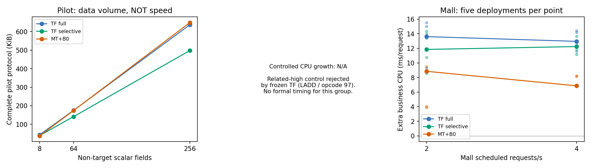

# 无关工作扩张：冻结版短试点与Mall负载验证

**受控组有实际观测省略，但相关高档对照被冻结TF拒绝，未进入正式计时；因此本轮不能判断TF selective的额外在线成本是否随无关工作增长得更慢。** Mall作为独立真实负载验证，不能补上这一增长趋势证据。所有首次、装配失败及旧成本表保留；没有修改核心、Agent或公共契约，没有推送。

**Mall正式验证：8100个工具目标实例全部来源正确；selective相比固定MT的额外CPU，2 req/s多4.508 ms/请求、4 req/s多5.411 ms/请求，五轮均更高。selective对full的CPU变化方向不一致。** 这些是同一单字段任务的负载结果，不是无关工作扩张趋势。

## 版本与封存

冻结核心：`bcdf0590d1b22ea13717afded657a062f070e1df`；139项源码逐项保持。Agent SHA256：`367cbb2300e507e5db4716c4e2fcbed1a39898c5e6c6f5f23583c4c1487e2764`。原生MT及固定B0适配器、JDK8u504的java/rt.jar/libjvm.so、原业务JAR与镜像ID/digest均在运行前协议逐文件锁定。新受控程序、元数据、计划与三次装配修正另有收据；四配置在每档使用相同业务JAR和依赖。MT不能关闭的多字段导出、诊断和class dump保留，协议字节与全部capture文件分别计数。

主协议：`artifacts/unrelated-work-scaling-20261109/protocol-before-tools.json`。受控组固定8/64/256个非目标long字段；受控桩源`bench.Store.read`，唯一目标`/target`，源值1009不变，其余字段含重复值且均实际赋值、返回并序列化。不同档位JAR只按预设生成字段、赋值和访问器；同档四配置共用同一JAR。相关高档另将全部256字段实际相加进入目标，独立真值要求257个本次源字段出现，不能沿用单一来源。查询、来源、档位及规则在工具规划前封存。

## 受控短试点：能力、实际省略及停止线

| 档位 | TF full | TF selective | 固定MT | selective实际省略载荷/6请求 | 完整协议字节：full / selective / MT |
| --- | --- | --- | --- | ---: | --- |
| low（8字段） | 6/6 | 6/6 | 6/6 | 48 | 44129 / 39849 / 38218 |
| medium（64字段） | 6/6 | 6/6 | 6/6 | 384 | 179147 / 144636 / 178258 |
| high（256字段） | 6/6 | 6/6 | 6/6 | 1536 | 651975 / 509772 / 664258 |
| related-high（256字段） | 规划拒绝 | 规划拒绝 | 6/6 | 0 | N/A / N/A / 807994 |

三档无关工作四配置业务均6/6保持；每个工具JVM使用自己的本次源调用、对象、字段和版本独立评分。保留成员的来源不按值连接。相关高档原版和MT也6/6保持，MT257个来源出现逐项匹配；TF在规划前因`LADD`（opcode97）拒绝，原版对应6个目标保留为planning_rejected义务；没有TF物理实例，不伪称unknown、来源正确或业务N/A。按试点门槛，本组不做五轮速度表，不改成int、不换任务、不放宽解释器。

省略发生在`ResponseBindingHooks.walk`的非目标标量分支，位于反射Field.get之前；成员身份、字段坐标、版本、调用/完成和完整性证据仍保留。事件数没有随载荷省略下降；原有selective响应字段持久化投影也保持开启，不能把full/selective全部字节差归给源快照的标量值投影。协议字节减少不直接说明在线CPU提速。另用既有内部计数探针核验实际取值工作，诊断耗时不进入正式速度表。

| 诊断档位 | Field.get次数 full / selective | JSON编码调用 full / selective | 实际载荷省略 |
| --- | ---: | ---: | ---: |
| low | 192 / 144 | 113 / 113 | 48 |
| high | 4656 / 3120 | 1601 / 1601 | 1536 |

高档仍保留大量getter/序列化及必要状态事件；编码调用次数并未下降。可以主张该边界少取值、少构建字段载荷和少持久化，不能主张省去了整段无关业务或按比例减少CPU。

## Mall：同任务真实负载

目标保持`/data/expiresIn`，来源保持本次`AuthService.getAccessToken`实际调用返回字段；不认证额外旁路字节的完整投影。输入admin/macro123来自公开SQL种子，正常OAuth签发。逐部署核对完整响应（仅新token和有界时钟TTL归一化）、本JVM实例来源以及登录日志新增次数。无Agent预检4、8req/s后，按100%业务完成、达到计划速率至少98%、p95<500ms的事前规则锁定[2, 4]req/s；在任何工具正式计时前保存负载锁定记录。

每档五轮独立部署，轮内随机四配置顺序；预热30秒、测量60秒、并发上限2。正确性覆盖预热与测量，在线指标仅测量期。三个业务JVM均1CPU/768MiB、相同256MiB堆；MySQL/Redis/Mongo/Rabbit资源沿用固定原环境；客户端CPU排除，未宣称独占机器。正式运行无探针或profiler。

**主指标为同轮同档工具CPU秒/完成请求，减去无AgentCPU秒/完成请求。** CPU取测量前后原始累计计数差，三业务容器相加；保存各容器计数时刻及窗口跨度，不用CPU百分比乘请求耗时推算。边界Docker采样开销/空闲CPU在窗口内；四配置口径相同，未扣除为理想业务CPU。负差值保留，不取绝对值或截为0。

| 负载 | 配置 | CPU ms/请求，中位数 | 相对原版额外CPU ms/请求，中位数［五轮范围］ | p95 ms，中位数 | 实际完成req/s，中位数 | RSS均值MiB |
| --- | --- | ---: | --- | ---: | ---: | ---: |
| 2 req/s | original | 120.386 | 0.000［0.000–0.000］ | 118.924 | 2.000 | 859.54 |
| 2 req/s | full | 132.682 | 13.602［9.312–15.522］ | 126.541 | 2.000 | 911.21 |
| 2 req/s | selective | 132.113 | 11.848［8.564–14.328］ | 126.813 | 2.000 | 909.29 |
| 2 req/s | mirrortaint | 127.199 | 8.852［3.860–13.738］ | 123.166 | 2.000 | 900.21 |
| 4 req/s | original | 110.768 | 0.000［0.000–0.000］ | 115.695 | 3.993 | 865.12 |
| 4 req/s | full | 123.947 | 12.953［11.557–14.414］ | 125.835 | 3.992 | 948.24 |
| 4 req/s | selective | 122.804 | 12.242［11.152–13.628］ | 127.322 | 3.992 | 943.94 |
| 4 req/s | mirrortaint | 117.773 | 6.859［6.807–8.221］ | 121.807 | 3.993 | 929.86 |

- 2 req/s：selective−full：-0.655［-6.959–2.536］ms/请求，方向不一致；selective−mirrortaint：4.508［0.247–6.888］ms/请求，五轮均较高；三种工具共2700/2700来源正确，最低请求完成比例1.000。
- 4 req/s：selective−full：-1.142［-3.262–0.900］ms/请求，方向不一致；selective−mirrortaint：5.411［3.590–5.493］ms/请求，五轮均较高；三种工具共5400/5400来源正确，最低请求完成比例1.000。

| 负载/配置 | 完整协议MiB | 测量请求可归属MiB（非全部） | 正常离线墙时/CPU s | VmHWM MiB | 独立真值与评分墙时s |
| --- | ---: | ---: | --- | ---: | ---: |
| 2/full | 38.685 | 19.829 | 2.284 / 2.282 | 288.29 | 1.811 |
| 2/selective | 35.196 | 17.826 | 2.009 / 2.004 | 261.15 | 1.563 |
| 2/mirrortaint | 3.648 | 2.205 | 0.135 / 0.131 | 45.32 | 0.024 |
| 4/full | 77.450 | 39.714 | 4.905 / 4.900 | 547.64 | 8.009 |
| 4/selective | 70.450 | 35.698 | 4.245 / 4.242 | 493.43 | 6.793 |
| 4/mirrortaint | 7.301 | 4.413 | 0.367 / 0.363 | 68.08 | 0.150 |

绝对值列为五次部署中位数，额外开销列先按同轮同档相减再取中位数，不能用两列中位数相减替代。p95使用完成测量请求的最近秩分位数；没有把完成当前负载等同于最大吞吐。完整批次含启动、准备和关闭；请求归属在全部计时后按实际消息、Frame祖先、已验证RPC的parent_message及具体span父链统一复核，不仅凭trace-id相同归并；初始审计中的same-trace合并数字保留但不入新表。未配对/共享部分仍留在完整量中。MT的native-capability/instances/library协议与全部class dump/诊断文件分列于CSV，不能将协议字节当全部写入I/O。正常离线fresh-exec不调用独立oracle，包含所需解码、来源/证书/完整性检查、还原、查询和导出；独立审计进程中的原始真值生成/判分阶段另列，不含该进程重复重建、启动及最终汇总导出。逐份正常流程预测与独立评分时的预测完全相同。初始正常流程JSON的VmHWM_KiB键实际来自resource.ru_maxrss，不能直接当作fresh-exec的/proc VmHWM；在线全部结束后对全部30份相同完整捕获统一复算，以/proc/self/status读取VmHWM，保留ru_maxrss作诊断，并将实验用的旧/新预测文件一致性比较移到计时子进程之外，全部必要的正常认证检查保留；旧计时/内存文件不覆盖。表中正常离线计时和内存统一使用该次完整复算；只有计量口径修正，没有核心优化或在线数值回填。

## 能回答什么

- **答案是否保持**：受控无关三档保持；相关高档TF拒绝，MT独立核验正确。Mall结果见逐轮CSV与原始实例评分，不由业务200代替来源正确。
- **观测是否减少**：受控组减少非目标载荷及相应监测取值，实际业务字段读写/序列化不删除；事件、身份与必要核验保持。不能将字节降幅换算CPU节省。
- **在线额外成本增长是否更慢**：未建立。缺少通过共同来源验收的相关高档控制，受控组没有正式CPU增长数据。
- **Mall结论边界**：这是不同到达率下的同任务成本与取舍；没有改变无关字段数，不能作为受控增长规律的复现。五轮逐轮差值/范围保留，不把请求当独立重复，不按某个改善指标宣布整体胜出。

## 失败、版本与复核

原受控装配的Boot目录项缺失、Cloud/Nacos依赖及组件扫描目录导致的404均保留在最初pilot和controlled-build各目录；业务结构、输入与来源未替换，修正仅限实验JAR装配。所有旧报告、旧成本表、首次和失败捕获未改写。25项本次原始调用错配/缺失/重复/版本及粘性无效检查通过；实际Jackson ObjectMapper字节码与同档业务JAR一致。归档第一次预检把digest引用直接与Image ID比较而拒绝，修正为按封存清单映射ID后重做；原失败日志保留，未改捕获或重新部署。此次能力范围不替代历史矩阵或完整40API验收。

主工件：`artifacts/unrelated-work-scaling-20261109/`；协议、全部计划/JAR/运行命令、来源坐标、资源累计计数、短试点、正式随机顺序和失败均保留。小型CSV、图与JSON随Git；本机完整归档及镜像/JDK引用见`unrelated-work-scaling-backup-20261109.json`，不是异地副本。

[逐轮CSV](unrelated-work-scaling-rounds-20261109.csv)、[试点表](unrelated-work-scaling-pilot-20261109.csv)、[结果JSON](unrelated-work-scaling-results-20261109.json)、[运行前协议](unrelated-work-scaling-protocol-20261109.json)和[独立计数/作用域复核](unrelated-work-scaling-verification-20261109.json)随Git。



```bash
python3 experiments/sockshop-mirrortaint/check_unrelated_work_scaling.py --out /tmp/tf2-scaling-check-new
python3 experiments/sockshop-mirrortaint/verify_unrelated_work_delivery.py --out /tmp/tf2-scaling-counter-new
python3 experiments/sockshop-mirrortaint/summarize_unrelated_work_scaling.py --out /tmp/tf2-scaling-summary-new
```

输出须用新目录；这些命令只复核既有证据与派生表，不是重新部署或重新计时。新部署入口为`execute_unrelated_work_scaling.py`，各阶段目录必须不存在，按协议顺序执行。代码及小型结果提交main，未push。
